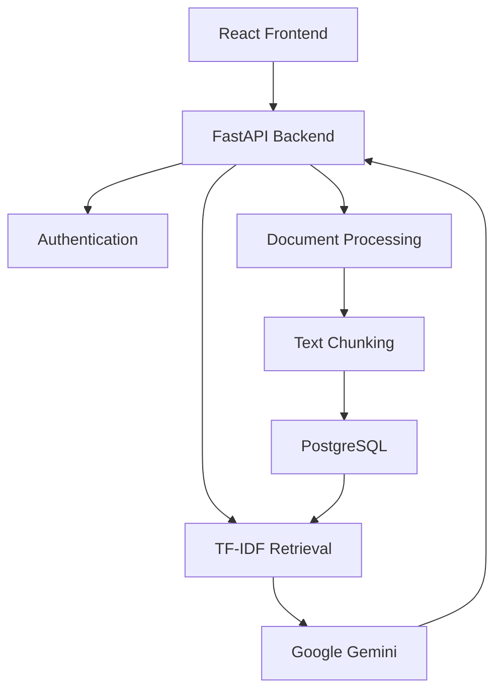

# DocuMind AI

An intelligent full-stack document assistant that transforms
documents into contextual answers, summaries and insights
using retrieval-augmented generation and Google Gemini.

## Features

- Secure JWT authentication with Argon2 password hashing
- PDF, DOCX and TXT document processing
- Personal document library
- Drag-and-drop document uploads
- TF-IDF document retrieval and cosine similarity
- Context-aware AI conversations
- AI-generated document summaries
- Clickable source references
- Persistent conversation history
- Responsive dark SaaS interface
- Account-isolated document access

## Technology Stack

### Frontend

- React
- TypeScript
- Vite
- Tailwind CSS
- Framer Motion
- Axios
- Lucide React

### Backend

- Python
- FastAPI
- SQLAlchemy
- PostgreSQL
- PyMuPDF
- python-docx
- scikit-learn
- Google Gemini API
- JWT
- Argon2

### Infrastructure

- Vercel
- Render
- Neon PostgreSQL

## Architecture

## How the AI Pipeline Works

1. The user uploads a document.
2. The backend extracts readable text.
3. The text is divided into overlapping chunks.
4. Chunks are stored in PostgreSQL.
5. Relevant passages are retrieved using TF-IDF.
6. The selected context is sent to Google Gemini.
7. The generated answer and source references are returned.
8. Conversation history is persisted.

## Local Development

### Backend

Create and activate a Python virtual environment.

Install dependencies:

    pip install -r requirements.txt

Copy .env.example to .env and configure your database,
JWT secret and Gemini API key.

Start the backend:

    python -m uvicorn main:app --reload --port 8000

API documentation:

    http://localhost:8000/docs

### Frontend

Install dependencies:

    npm install

Copy .env.example to .env.

Start the development server:

    npm run dev

Application:

    http://localhost:5173

## Limitations

- Maximum document size: 10 MB.
- Scanned PDFs without readable text are not supported.
- Retrieval uses lexical similarity rather than embeddings.
- Large document summaries may use sampled passages.
- Document previews display extracted text.
- AI-generated answers may contain inaccuracies.

## Privacy

This project is intended as a portfolio demonstration.
Use non-confidential documents only. Relevant document
passages are sent to Google Gemini during AI requests.

